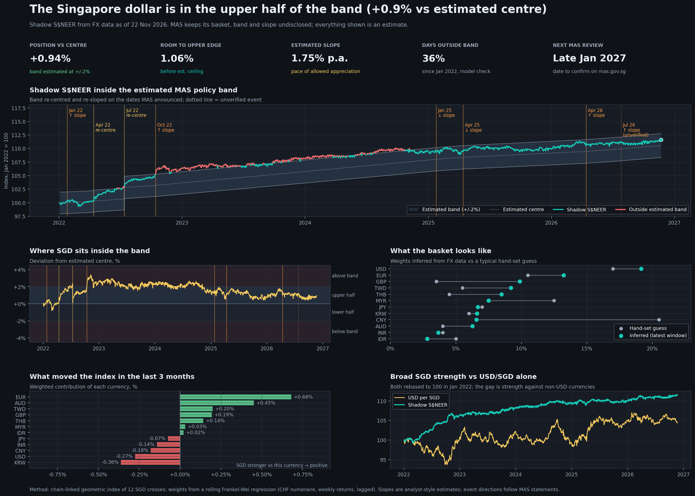
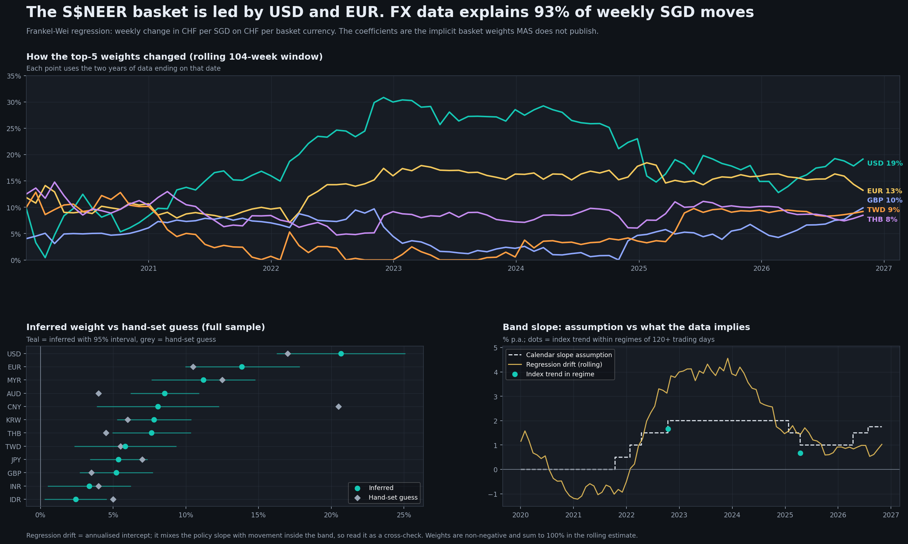

# SGD-NEER-shadow-model

Transparent shadow S$NEER model for studying Singapore dollar exchange-rate policy.

MAS manages the Singapore dollar against an undisclosed trade-weighted basket
(the S$NEER), inside an undisclosed policy band whose slope, width and centre
it adjusts in its Monetary Policy Statements. This project tries to
reverse-engineer both from public FX data.

## Interactive dashboard

`docs/` holds a static web page with an interactive version of the model:

- switch between basket-weight modes
- change the band width
- edit the slope of each MAS policy move
- every number and chart updates live

The page recomputes the policy band in the browser. On load it checks its
result against the Python numbers stored in `docs/data.json`, and logs the
outcome to the console.

- **Refresh the data:** `python3 export_web.py`, which writes `docs/data.json`.
- **Preview locally:** `python3 -m http.server 8765 --directory docs`, then
  open http://localhost:8765.
- **Publish:** in GitHub, go to *Settings → Pages → Deploy from a branch* and
  choose `main` with the `/docs` folder.
- **Daily refresh:** `.github/workflows/update-data.yml` runs on weekdays. It
  runs the tests, re-exports the data, and commits `docs/data.json` when the
  data changed. It can also be started by hand from the *Actions* tab.

## What it does

1. **Reverse-engineers the basket** (`basket_inference.py`). A Frankel-Wei
   regression of weekly SGD returns on basket-currency returns, all measured
   in an outside numeraire (CHF). The coefficients are the implicit basket
   weights. The model reports full-sample OLS with standard errors and a
   rolling 104-week non-negative, sum-to-one estimate. The annualised
   intercept is a data-implied cross-check on the band slope.
2. **Builds the shadow index** (`SGD.py`). A chain-linked geometric index of
   SGD crosses. By default it uses the rolling inferred weights with a one-day
   lag, so there is no look-ahead.
3. **Draws a piecewise policy band** (`mps_calendar.py`, `policy_band.py`).
   The band follows the dated MAS policy calendar: slope changes on slope
   dates, and re-centring at the prevailing level on re-centre dates. After
   the last re-centre (July 2022) the band has no fitted parameters, so time
   spent outside it is a real test of the slope assumptions.

## Current findings (data to 22 Nov 2026)

| | Hand-set weights + single slope (old) | Inferred rolling weights + MPS calendar (new) |
|---|---|---|
| Days outside ±2% band | most of the sample | 36% |
| Latest position vs centre | +2.5% (outside band) | +0.9% (upper half) |

- The basket explains about 93% of weekly SGD moves (R² 0.93).
- USD (~19–21%) and EUR (~13–14%) carry the largest inferred weights. CNY is
  far below the 20% often assumed (~7–8%), partly because it moves closely
  with USD.
- The rolling weights show USD's weight rising through 2022–24 and easing
  since 2025.
- Remaining time outside the band is concentrated in late 2022 to 2024, when
  the proxy sits about 0.5–1% above the estimated upper edge. Possible causes
  are proxy error, or a 2022–24 slope or width different from the assumed one.

## Accuracy notes

- MAS does not disclose the basket, weights, centre, slope or band width.
  Everything here is an estimate.
- Slopes in `mps_calendar.py` are analyst-style assumptions. The *direction*
  of each change comes from MAS statements. Rows marked `verified=False`
  (currently July 2026) rely on press reports; check them against
  [MAS monetary policy statements](https://www.mas.gov.sg/monetary-policy).
- Restricted currencies (CNY, KRW, TWD, INR, IDR) use Yahoo quotes, which can
  be stale or noisy.
- Weekly returns are used for the regression because Asian and Western FX
  closes are asynchronous.

## Configure

In `SGD.py`:

- `WEIGHT_MODE`: `"inferred_rolling"` (default), `"inferred_full"` or `"assumed"`
- `ROLLING_WINDOW_WEEKS`: regression window length
- `FIXED_BAND`: half-width of the estimated band

## Run

```bash
pip install -r requirements.txt
python3 SGD.py
python3 -m pytest -q tests
```

Outputs:

- `sgd_neer_dashboard.png`: the index against the policy band
- `sgd_basket_inference.png`: rolling weights, OLS intervals, and slope cross-check
